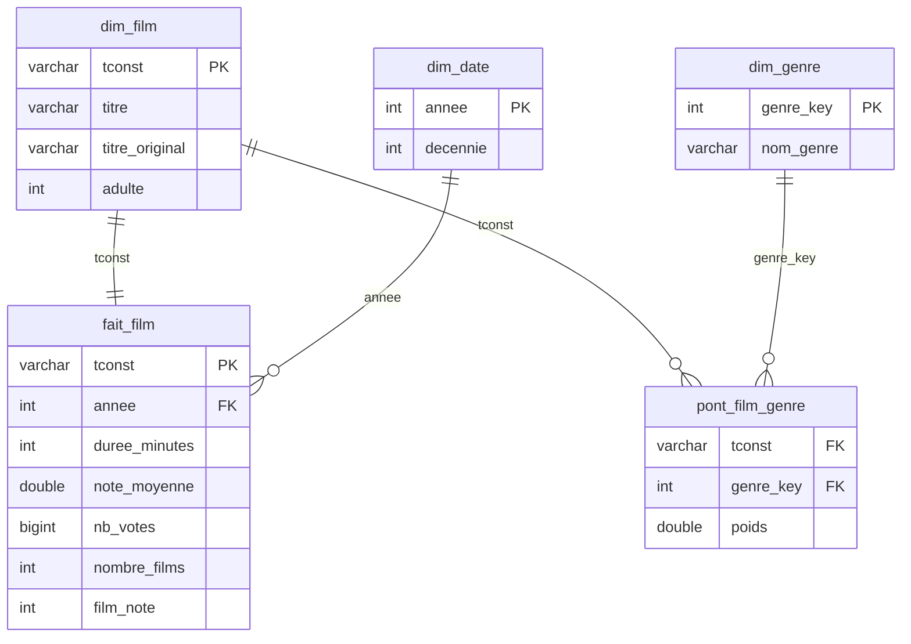

# Schéma dimensionnel IMDb

Le grain de `fait_film` est **une ligne par film** (`tconst`). `dim_film` et `dim_date` sont reliées à la table de faits. La relation films-genres est plusieurs-à-plusieurs et passe par `pont_film_genre`. Le champ `poids` permet un décompte pondéré sans double comptage lorsqu'on agrège sur tous les genres.

**À retenir :** les flèches désignent des relations logiques (et non nécessairement des contraintes SQL physiquement déclarées). Un film n'a pas toujours d'année ou de genre ; les relations facultatives doivent être traitées correctement dans le dashboard. Pour produire `docs/schema_etoile.png`, ouvrir l'aperçu Markdown/Mermaid dans VS Code ou un éditeur Mermaid et exporter le diagramme en PNG.
